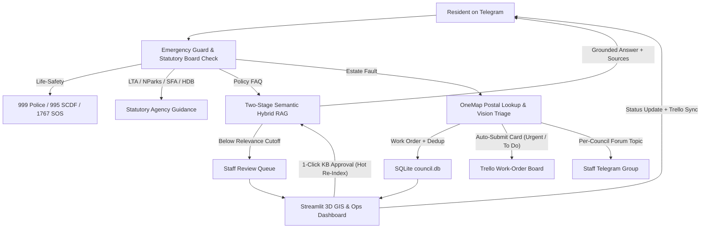

# Town Council Request Classifier (EstateKaki)

Real-time Telegram resident assistant, Semantic Hybrid RAG policy engine, and automated work-order ticketing pipeline for **all 17 Singapore Town Councils**.

## Overview

**EstateKaki** unifies 24/7 resident FAQ answering and estate fault reporting inside Telegram (zero app install required), paired with a live Streamlit Staff Operations Dashboard and optional **Trello Work-Order Dispatch**.

### Key Features

- **Upgraded Two-Stage Semantic Hybrid RAG (`semantic_rag.py` + `rag.py`)**:
  - Structure-aware Markdown & section chunking with **100% atomic table preservation** and sentence-level semantic breakpoint splitting.
  - **Contextual Breadcrumb Injection** (`[Document | Section]`) and **Small-to-Big Parent Context** assembly.
  - **Hybrid Retrieval**: dense vector similarity (`gemini-embedding-001` with deterministic offline fallback) fused with sparse exact & Town Council priority token boosting (`1.2m`, `S&CC`, `EMSU`, `$5,000`, `10:30 PM`).
  - **Singapore HDB / Singlish Query Expansion** bridging casual resident phrasing (*"throw old sofa"*, *"corridor barang"*) to official Town Council policies.
  - **Strict Staff-Escalation Refusal Gate**: refuses out-of-scope questions instead of hallucinating and routes them to council staff.
  - **Zero-Downtime Hot Re-Indexing**: staff answers approved in the dashboard become searchable immediately without restarting `bot.py`.
- **17 Singapore Town Council Auto-Routing (`council_lookup.py` + `create_topics.py`)**:
  - Resolves 6-digit Singapore postal codes, street names, and GPS pins via the **OneMap API** and maps them to the responsible Town Council.
  - Posts alerts directly into per-council **Telegram Forum Topics** (`#ang-mo-kio`, `#tampines`, etc.).
- **Pre-LLM Safety Guard & Statutory Agency Deflection**:
  - Instant regex emergency interception for life-safety crises (**999 Police / 995 SCDF / 1767 SOS**).
  - Automatic jurisdiction routing for **LTA** (bus stops/roads), **NParks** (wildlife/bee hives), **SFA** (hawker stalls), and **HDB** (internal flat defects).
- **AI Vision Fault Inspection & Smart Duplicate Merging (`vision.py` + `db.py`)**:
  - Gemini Vision diagnoses uploaded fault photos, assigns severity, and suggests the maintenance crew.
  - Detects duplicate active reports at the same postal code/location and subscribes neighbours to the existing ticket for live updates.
- **Automated Trello Work-Order Dispatch (`trello_client.py`)**:
  - Automatically submits resident fault reports as structured Trello cards (routing **High / Critical** faults straight to `Urgent` with SLA due dates and routine faults to `To Do`).
  - Logs duplicate neighbour subscriptions as card comments and syncs `/progress`, `/resolve`, and dashboard status updates to `In Progress` / `Done` lists.
- **PDF-to-Markdown Handbook Ingestion (`pdf_converter.py` + `ingest.py`)**:
  - Converts uploaded or dropped `.pdf` Town Council circulars/handbooks into clean Markdown inside `data/docs/`, preserving tables, removing page-number noise, healing page-break splits, and automatically falling back to Gemini Vision OCR for scanned PDFs.
- **Handbook Policy Copilot — Human-in-the-Loop (`policy_editor.py`)**:
  - Officers can amend any policy document in plain English, preview GitHub-style color-coded HTML diffs, apply surgical in-place edits with timestamped backups + immutable JSON audit logs, trigger zero-downtime RAG hot re-indexing, and perform 1-click rollbacks.
- **Staff Operations Dashboard (`dashboard.py`)**:
  - Interactive **3D PyDeck GIS incident map** across Singapore, ticket queue with photo & Trello links, unanswered Q&A learning loop, **KB & Policy Copilot** (FAQ tester, PDF uploader, HITL diff editor), and analytics.

## Architecture



## Project Structure

```text
town-council-request-classifier/
├── council-bot/
│   ├── bot.py                  # Telegram bot handlers, ticket flow & staff commands
│   ├── semantic_rag.py         # Two-Stage Semantic Hybrid RAG engine & hot re-indexer
│   ├── pdf_converter.py        # Lossless PDF-to-Markdown ingestion & OCR fallback
│   ├── policy_editor.py        # Human-in-the-Loop Policy Copilot, diffs, audit & rollback
│   ├── rag.py                  # RAG facade + intent/category router
│   ├── trello_client.py        # Trello work-order submission & status sync
│   ├── dashboard.py            # Streamlit 3D GIS map, tickets, PDF/Policy Copilot & FAQ tester
│   ├── vision.py               # Gemini Vision photo damage inspection
│   ├── council_lookup.py       # OneMap API, postal sector & statutory agency router
│   ├── create_topics.py        # Auto-creates 17 Town Council Telegram forum topics
│   ├── db.py                   # SQLite persistence (tickets, subscribers, Trello IDs, logs)
│   ├── config.py               # Environment settings, RAG thresholds & emergency regex
│   ├── ingest.py               # PDF-to-MD conversion, semantic chunking & index builder
│   ├── eval.py                 # RAG benchmark harness (Hit Rate @ 3, MRR, Refusal Acc.)
│   ├── tests.json              # 27 Singapore Town Council + refusal evaluation queries
│   ├── test_suite.py           # Pytest automated test suite (RAG, PDF, Policy, Routing, Trello)
│   ├── seed_demo.py            # Demo data seeder for live presentations
│   ├── requirements.txt        # Python dependencies
│   ├── .env.example            # Environment variable template (Telegram, Gemini, Trello)
│   ├── data/docs/              # 9 official Singapore Town Council policy guides
│   └── data/benchmarks/        # FAQ & request benchmark CSV datasets for RAG testing
├── .gitignore
└── readme.md
```

## Quick Start

### 1. Environment Setup
```bash
cd council-bot
python -m venv .venv
# Windows:
.venv\Scripts\activate
# macOS / Linux:
source .venv/bin/activate

pip install -r requirements.txt
```

### 2. Configure Environment Variables
```bash
cp .env.example .env
```
Fill in `.env`:
- `TELEGRAM_TOKEN` — Bot token from `@BotFather`
- `STAFF_CHAT_ID` — Telegram staff group ID (send `/chatid` in the group)
- `GEMINI_API_KEY` — Google AI Studio key (for Semantic RAG embeddings, synthesis, and Vision; optional — offline deterministic fallback works out of the box)
- *(Optional Trello Work Orders)* `TRELLO_BOARD_ID`, `TRELLO_API_KEY`, `TRELLO_TOKEN` (with `To Do` and `Urgent` lists on your board; `In Progress` and `Done` are auto-detected if present)

### 3. Build the Semantic RAG Index
```bash
python ingest.py
```

### 4. Launch the Telegram Bot & Staff Dashboard
In terminal 1:
```bash
python bot.py
```
In terminal 2:
```bash
streamlit run dashboard.py
```

## Evaluation & Automated Tests

Run the RAG benchmark (Hit Rate @ 3, MRR, In-Scope Accuracy, and Out-of-Scope Refusal):
```bash
cd council-bot
python eval.py
```

Run the automated pytest suite (Semantic RAG, hot re-indexing, routing, duplicate merging, and mocked Trello work-order submission):
```bash
cd council-bot
pytest test_suite.py -v
```

## License

Distributed under the MIT License.
