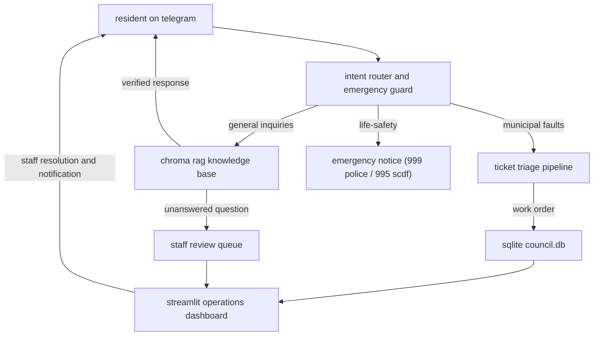

# town council request classifier

real-time telegram resident assistant and ticketing triage pipeline for singapore town councils.

## overview

**town council request classifier** (estatekaki) is an automated resident support and municipal issue reporting pipeline designed for town councils. built with a pre-llm emergency triage guard, grounded retrieval-augmented generation (rag), and an operations workbench, the bot answers resident bylaws inquiries and routes physical estate faults directly to staff.

residents interact directly via telegram with zero apps to install, while council officers manage, inspect, and resolve tickets through a real-time streamlit operations dashboard.

## what we've been building

- **grounded inquiry answering**: resident queries (e.g. bulky waste collection, parking permit fees, corridor obstruction rules) are answered strictly from official council documents using vector embeddings with distance cutoffs. if the bot is unsure, it escalates to human staff rather than guessing.
- **smart issue reporting & ticketing**: residents report municipal faults (broken streetlights, potholes, lift breakdowns, pest infestations) via natural chat. the bot collects location details, requests photo verification, and creates tracked work order tickets.
- **pre-llm emergency detection**: regex and keyword triggers intercept life-threatening reports (fire, gas leaks, cardiac emergencies) before any model inference, immediately routing residents to official emergency lines (999 police, 995 scdf, 1767 crisis hotline).
- **staff operations dashboard (`dashboard.py`)**: a live streamlit management desk with ticket queue tables, photo inspection, department routing, and one-click status updates that notify residents on telegram automatically.
- **continuous knowledge loop**: staff answers to previously unanswered resident questions can be approved into the knowledge base with a single click, allowing the bot to learn autonomously.

## architecture



## project structure

```
town-council-request-classifier/
├── council-bot/
│   ├── bot.py                  # telegram bot event handlers and resident ticket flow
│   ├── dashboard.py            # streamlit staff operations dashboard and kanban
│   ├── rag.py                  # vector retrieval and grounded answering pipeline
│   ├── vision.py               # image inspection and damage verification
│   ├── db.py                   # sqlite persistence for tickets, logs, and feedback
│   ├── council_lookup.py       # postal code and constituency boundary lookup
│   ├── config.py               # environment configuration and emergency regex patterns
│   ├── ingest.py               # document chunking and vector embedding into chroma
│   ├── eval.py                 # automated accuracy and refusal evaluation harness
│   ├── seed_demo.py            # demo dataset seeder for live presentations
│   ├── requirements.txt        # python dependencies
│   ├── assets/                 # bot identity avatars and presentation graphics
│   └── data/docs/              # official town council bylaws and service guides
├── .gitignore                  # environment and local database exclusion rules
└── readme.md                   # this documentation
```

## quick start

### 1. environment setup
navigate into the council bot directory and activate your virtual environment:
```bash
cd council-bot
python -m venv .venv
source .venv/bin/activate  # on windows: .venv\Scripts\activate
pip install -r requirements.txt
```

### 2. configuration
copy the environment template and provide your bot token:
```bash
cp .env.example .env
```
configure your `TELEGRAM_TOKEN` from botfather and set `STAFF_CHAT_ID`.

### 3. ingest knowledge base
embed town council policies and service schedules into the local chroma vector store:
```bash
python ingest.py
```

### 4. launch the resident bot
```bash
python bot.py
```

### 5. launch the staff operations dashboard
in a separate terminal, open the management workbench:
```bash
streamlit run dashboard.py
```

## evaluation & benchmarking
run the accuracy and refusal test suite:
```bash
python eval.py
```

## license

distributed under the mit license.
